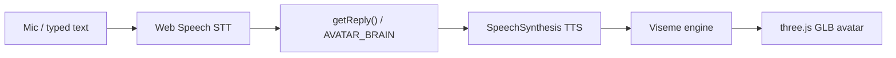

# Face Time for Agents

**Give any chatbot or agent a face: a free, no-API-key, no-GPU, lip-synced 3D avatar that listens, thinks and talks back, right in the browser.**

## What it does

- **Listens** with the browser Web Speech `SpeechRecognition` API (Chrome only, free). You can also just type.
- **Thinks** through a swappable `getReply()`. The default is a small rule-based placeholder; plug in an LLM or Agentforce with `window.AVATAR_BRAIN = async (text) => "..."`.
- **Speaks** with `SpeechSynthesisUtterance` (local TTS, 10 languages in the dropdown).
- **Lip-syncs** by driving viseme morph targets (`viseme_aa`, `viseme_O`, `jawOpen`, ...) on a three.js avatar in time with the speech, plus idle blink and subtle sway.
- **Embeds in Salesforce** (optional): the `salesforce/` folder holds the LWCs that put the same face into an Agentforce / Experience Cloud Embedded Messaging chat header.

Why it looks the way it does: photoreal, real-time and free can't all coexist (photoreal real-time needs a GPU or a paid service such as Tavus, HeyGen Interactive, Simli or D-ID). This prototype takes the achievable middle: free, real-time, stylized-but-realistic 3D.

## Run it (browser prototype)

```bash
git clone <this-repo> && cd face-time-for-agents
python3 -m http.server 8777
```

Open <http://localhost:8777/index.html> in **Chrome**. It must be served over `http://localhost`; opening the file as `file://` disables the microphone (not a secure context). three.js is loaded from the jsDelivr CDN via an import map, so you need internet access on first load.

## Architecture



Key code (all in `index.html`): `initThree()` (renderer, tone mapping, room IBL, 3-point lights), `loadAvatar(url)` (GLTFLoader + Meshopt, framing), `VISEME_SETS` / `startMouth()` / `stopMouth()` / `emphasize()` (lip-sync), `getReply()` (the brain hook), `speak()` / `buildRecognition()` / `handleUserText()` / `startSession()` (conversation loop).

## Avatars

`avatars/` ships a deliberately small set (about 13 MB total, every file well under 50 MB, so no Git LFS is needed):

| File | Source (from the file's glTF metadata) |
|------|-----------------------------------------|
| `aria-rpm.glb` (default) | Ready Player Me |
| `brunette.glb`, `brunette-t.glb` | Ready Player Me (as distributed with [met4citizen/TalkingHead](https://github.com/met4citizen/TalkingHead)) |
| `vroid.glb` | VRoid-style model, re-exported with glTF-Transform (as distributed with TalkingHead) |

To add more, drop any `.glb` that carries ARKit + Oculus viseme morph targets into `avatars/` and add an `<option>` in the `avatarPreset` select. The TalkingHead repo lists more sample avatars (Avaturn, Avatar SDK, MPFB/MakeHuman) under `avatars/`; they are not bundled here because their licences differ and the larger ones (up to 37 MB) would bloat the repo. If you want to carry big models, use Git LFS (`git lfs track "*.glb"`).

You can also paste a Ready Player Me `.glb` URL in the custom box. `normalizeAvatarUrl()` appends `?morphTargets=ARKit,Oculus+Visemes&textureAtlas=1024&lod=0` for RPM URLs. Note that Ready Player Me's hosted service may no longer be available.

## Embed in Agentforce / Experience Cloud (`salesforce/`)

An SFDX project that puts the avatar into a Salesforce Embedded Messaging (MIAW) chat.

| Component | Purpose |
|-----------|---------|
| `de_avatarFace` | LWC that loads the three.js bundle and GLB static resources, renders the face, and exposes `speak(text)`, `mute(bool)`, `prime()`, `language`, `big`. |
| `de_avatarBus` | Tiny in-iframe pub/sub singleton shared by the header and the bubble. |
| `de_avatarMessageBubble` | Custom text-message bubble (`lightningSnapin__MessagingTextMessageBubble`); publishes each inbound agent reply to the bus. |
| `de_custom_chat_header` | Custom header (`lightningSnapin__MessagingHeader`) that hosts the avatar, a voice toggle and a sample options menu. |
| `de_threeBundle` (static resource) | three.js r160 bundle (with GLTFLoader / Meshopt). |
| `de_avatarGlb` (static resource) | The avatar model (Ready Player Me). Static resources must use `cacheControl = Public` and be referenced without query params. |
| `docs/de_community_head_markup_avatar_relay.html` | Experience Cloud head markup. Embedded Messaging v2 gives a header LWC no API to read inbound text, so this host-page script listens for `onEmbeddedMessageSent`, extracts the agent reply and `postMessage`s it into the chat iframe (it also relays menu clicks back with `utilAPI.sendTextMessage`). |

Setup:

```bash
cd salesforce
sf project deploy start --source-dir force-app --target-org <alias>
```

Then in Setup, point your Embedded Service deployment's Header and Text Message Bubble at `DE Custom Chat Header` and `DE Avatar Message Bubble`, and paste `docs/de_community_head_markup_avatar_relay.html` into Experience Builder, Settings, Advanced, Head Markup (below your `embeddedservice_bootstrap` snippet). Keep the `console.log` line on during first setup to confirm the event payload shape in your org, then remove it. The header title and sample menu live in `de_custom_chat_header.js`; replace them with your own.

Security note: the relay script posts to the iframe with a `"*"` target origin; tighten it to your chat origin before production use.

## Configuration

No keys or env vars. Optional: set `RPM_SUBDOMAIN` in `index.html` to enable the in-app Ready Player Me creator, and set `window.AVATAR_BRAIN` to your own reply function.

## Screenshots

Add screenshots to `docs/screenshots/`.

## Third-party notices

- **three.js** (MIT, (c) three.js authors): loaded from jsDelivr in `index.html`, and bundled (r160) as `salesforce/.../de_threeBundle.js`, which also includes the GLTFLoader and meshopt decoder add-ons (MIT).
- **3D avatars**: the `.glb` files are third-party assets created with [Ready Player Me](https://readyplayer.me) and distributed in the [TalkingHead](https://github.com/met4citizen/TalkingHead) sample set (code MIT). The models themselves are not covered by this repo's MIT licence; their original licence files were not included with the copies, so confirm terms with the respective creators before commercial or redistributed use. Remove them if in doubt, since the app works with any compatible `.glb`.

## License

MIT for the code in this repository (see `LICENSE`); third-party assets as noted above.
